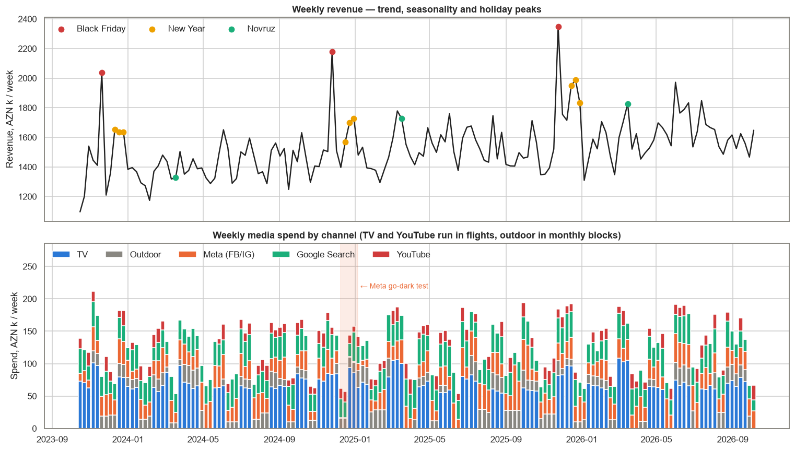
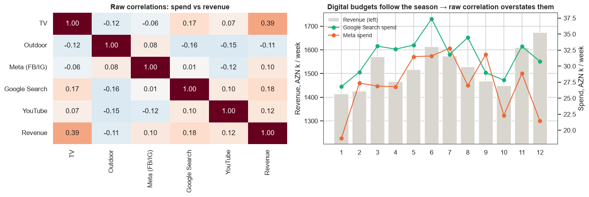
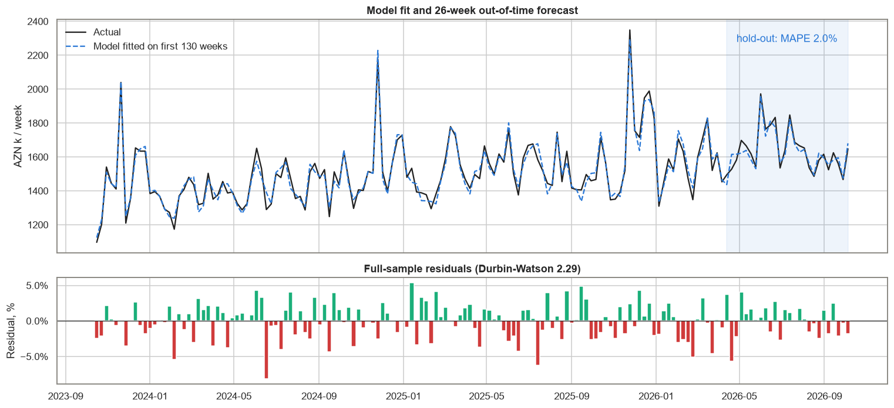
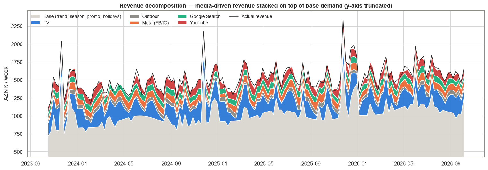
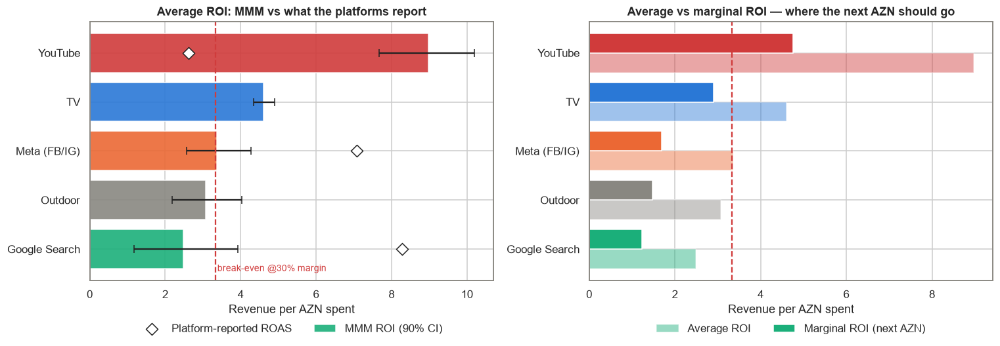
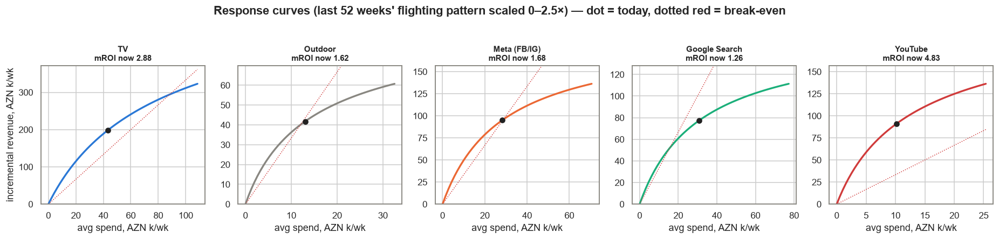
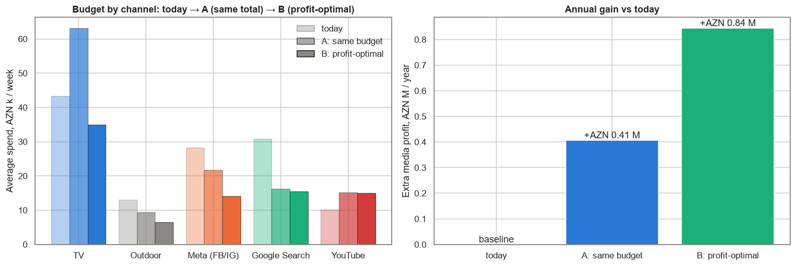

# Baku Online Electronics Retailer — Marketing Mix Modeling & Budget Optimisation

**Daily Data Analytics Project · Day 13**

## Business question
A Baku online electronics retailer spends about **AZN 6.5 million a year** on five channels: TV, outdoor billboards, Meta (Facebook/Instagram), Google Search and YouTube. Each ad platform reports its own ROAS, and on those dashboards Google Search is the clear winner. The CMO asks: **which channels really drive incremental revenue, which are saturated, and how should next year's budget be split, both with the same total and at the profit-optimal total?**

What the project does:
1. Cleans three years of weekly data (Oct 2023 – Oct 2026, 156 weeks): duplicate weeks, a USD/AZN currency mix-up, missing invoices.
2. KPIs and EDA: revenue, spend mix, seasonality, platform-reported ROAS, a Meta "go-dark" test.
3. **A Marketing Mix Model written from scratch**: geometric adstock + Hill saturation per channel, controls for trend, Fourier seasonality, holidays (Novruz, Black Friday, New Year), discounts and competitor promotions.
4. Validation: 26-week out-of-time hold-out, residual diagnostics and **parameter recovery against the known synthetic ground truth**.
5. Revenue decomposition, ROI and **marginal ROI** with moving-block bootstrap intervals, compared with platform ROAS.
6. Response curves and **budget optimisation** with SciPy (same budget re-allocated, and the profit-maximising budget).

## Key KPIs (from the executed notebook)
| KPI | Value |
|---|---|
| Revenue, last 52 weeks | AZN 84.8 M (YoY +6.8%), 273,559 orders, AOV AZN 310 |
| Media spend, last 52 weeks | AZN 6.54 M (7.7% of revenue) |
| Spend mix (3 years) | TV 34%, Search 25%, Meta 22%, Outdoor 11%, YouTube 8% |
| Platform-reported ROAS | Google Search **8.27**, Meta **7.08**, YouTube 2.63 (claims 31.5% of all revenue) |
| Model accuracy, 26-week hold-out | **MAPE 2.0%**, R² 0.90, bias −0.3% (naive "last year × growth": MAPE 7.7%) |
| Full-sample fit | MAPE 1.97%, R² 0.960, Durbin-Watson 2.29 |
| Media-driven share of revenue | **32.9%** (true value in the synthetic data: 35.0%) |
| ROI rank correlation with ground truth | 0.90 (platform ROAS ranks channels almost in reverse) |
| Break-even ROI (30% gross margin, assumed) | 3.33 revenue per AZN |

### ROI by channel (3 years)
| Channel | Spend, AZN M | Incremental revenue, AZN M | MMM ROI (90% CI) | Marginal ROI | Platform ROAS |
|---|---|---|---|---|---|
| YouTube | 1.56 | 14.04 | **8.98** (7.7–10.2) | **4.76** | 2.63 |
| TV | 6.68 | 30.82 | **4.61** (4.3–4.9) | 2.90 | — |
| Meta (FB/IG) | 4.25 | 14.31 | 3.36 (2.6–4.3) | 1.69 | 7.08 |
| Outdoor | 2.24 | 6.89 | 3.08 (2.2–4.0) | 1.48 | — |
| Google Search | 4.94 | 12.28 | **2.49** (1.2–3.9) | **1.23** | 8.27 |

### Budget scenarios (last 52 weeks' flighting pattern, each channel 50–150% of today)
| | Today | A: same budget re-allocated | B: profit-optimal |
|---|---|---|---|
| TV | 2.26 | 3.28 | 1.82 |
| Outdoor | 0.68 | 0.49 | 0.34 |
| Meta | 1.47 | 1.13 | 0.73 |
| Google Search | 1.61 | 0.84 | 0.80 |
| YouTube | 0.53 | 0.79 | 0.78 |
| **Total spend, AZN M** | 6.54 | 6.54 | 4.48 (−31%) |
| Media-driven revenue, AZN M | 26.21 | 27.56 (+1.36) | 22.16 (−4.05) |
| Media profit (30% × revenue − spend), AZN M | 1.33 | 1.73 (**+0.41**) | 2.17 (**+0.84**) |

## Charts
### Revenue and media spend


### Why raw correlations mislead: digital budgets follow the season


### Model fit and 26-week out-of-time forecast


### Revenue decomposition


### MMM ROI vs platform ROAS, average vs marginal ROI


### Response curves


### Budget re-allocation


## Findings & recommendations
| Area | Evidence | Recommendation |
|---|---|---|
| Measurement | Platforms claim 31.5% of all revenue for 3 channels; Search ROAS 8.3 vs MMM 2.5 | Stop allocating budget by platform ROAS; report MMM ROI and marginal ROI every quarter |
| YouTube | ROI 8.98 (7.7–10.2), mROI 4.76, least saturated | The only channel with marginal ROI above break-even: raise to the 150% cap, then test further with a geo experiment |
| TV | ROI 4.61 (4.3–4.9), mROI 2.90, biggest driver (12.9% of revenue) | Profitable on average, but extra TV buys revenue rather than profit: add only under a growth goal (A), otherwise trim slightly (B) |
| Google Search | ROI 2.49 (1.2–3.9), mROI 1.23, on the flat part of its curve | Cut by about half: brand-keyword and generic bids mostly harvest demand created by TV and YouTube |
| Meta | ROI 3.36 (2.6–4.3), mROI 1.69 | Average is at break-even, the margin is not: trim to 50–75% and run a proper geo-holdout (the December go-dark test was confounded by seasonality) |
| Outdoor | ROI 3.08 (2.2–4.0), mROI 1.48; the ground-truth check shows the MMM overstates it | Cut to the minimum contract and run a city-split test before renewing |
| Budget | Same budget re-allocated: +AZN 0.41 M media profit a year; profit-optimal: +AZN 0.84 M at −31% spend, but −4.8% revenue | Growth goal → A; profit goal → B. Move ±25% per quarter and re-fit the model after each step |

**Bottom line:** the platform dashboards point the budget the wrong way, towards Google Search, which mostly captures demand that TV and YouTube created. The MMM says video (YouTube, then TV) earns the most per extra manat, while Search, outdoor and Meta are saturated or below break-even at the margin. Re-allocating the same budget raises both revenue and profit. Cutting the saturated channels raises profit further but costs revenue, so that part is a growth-vs-profit decision for management.

*Caveats: 156 weekly points can identify only a few parameters, so the priors matter, and the widest intervals (Search, outdoor, Meta) should be calibrated with experiments. Hill shape is fixed at 1, while the true TV curve is S-shaped. The optimiser stays within 50–150% of observed spend. The 30% gross margin is an assumption, competitor activity is only a promo flag, and long-term brand effects beyond adstock are not modelled.*

## Methods
- **Adstock:** `a_t = x_t + θ·a_{t−1}` (geometric carry-over). **Saturation:** `h = a/(a + K)` with `a` scaled by the channel's mean adstock, so `K` is the half-saturation point relative to the average week.
- **Model:** `revenue = controls·γ + Σ β_c·h_c`, with **β ≥ 0** (bounded least squares, `scipy.optimize.lsq_linear`).
- **Estimation (variable projection):** the 10 non-linear parameters (θ, K) are found with `differential_evolution` on a MAP objective: Gaussian likelihood plus weakly-informative priors (θ around typical carry-over for each channel type, `log K ~ N(0, 0.5)`). For each candidate the linear coefficients are solved exactly. In development runs without the priors, saturation traded off against the intercept and Search's ROI came out several times too high.
- **Uncertainty:** moving-block bootstrap of residuals (8-week blocks, 400 draws) with the non-linear parameters fixed. This understates uncertainty a little.
- **Marginal ROI:** extra revenue from +1% spend on the channel's historic pattern ÷ the extra spend.
- **Optimisation:** each channel's last-52-week weekly pattern is scaled by a multiplier. A: `SLSQP` maximises revenue at a fixed total; B: `L-BFGS-B` maximises 30% × revenue − spend.
- **Ground-truth check:** the generator saves the true θ, K, β and ROI (`data/ground_truth.json`).

## Tech stack
Python · pandas · NumPy (**adstock / Hill MMM written from scratch**) · SciPy (`differential_evolution`, `lsq_linear`, `SLSQP`) · matplotlib · seaborn · nbformat / nbconvert

## Structure
```
data/generate_data.py          synthetic weekly data generator (seed 42) with injected data issues
data/marketing_weekly.csv      158 raw weekly rows: revenue, orders, spend by channel, platform-reported revenue, promos, holidays
data/ground_truth.json         true parameters and ROI used to generate the data
mmm.py                         cleaning, transforms, MMM fit, bootstrap, optimiser
build_notebook.py              builds the analysis notebook
marketing_mix_model.ipynb      executed analysis
images/                        charts
```

## Run
```bash
pip install -r requirements.txt
python data/generate_data.py
python build_notebook.py
python -m nbconvert --to notebook --execute --inplace marketing_mix_model.ipynb
```

> **Note:** all data is synthetic (fixed random seed). It does not describe any real company, its customers or its advertising.

## 🇦🇿 Azərbaycanca xülasə
Bakıdakı onlayn elektronika mağazasının 3 illik (156 həftə, sintetik data) marketinq məlumatı ilə **Marketing Mix Modeling (MMM)** qurulub. Model sıfırdan yazılıb: hər kanal üçün adstock (reklamın gecikmiş təsiri) və Hill doyma əyrisi, trend, mövsümilik, Novruz / Black Friday / Yeni il və endirimlər nəzərə alınıb. Model görmədiyi 26 həftəni **2.0% xəta** ilə proqnozlaşdırır. Platformaların öz hesabatları Google Search-ə 8.3, Meta-ya 7.1 ROAS yazır, amma MMM-ə görə real artım Search-də cəmi **2.5**, Meta-da 3.4-dür. Ən səmərəli kanal **YouTube**-dur (ROI 9.0, növbəti manatın gəliri 4.8), TV isə ən böyük sürücüdür (gəlirin 12.9%-i). 30% marja ilə break-even 3.33-dür: növbəti manat yalnız YouTube-da qazanc gətirir. **Eyni büdcəni** yenidən bölmək (Search və Meta-dan YouTube və TV-yə) media mənfəətini ildə **+0.41 mln AZN** artırır, mənfəət üçün optimal büdcə isə xərci 31% azaldıb mənfəəti +0.84 mln AZN artırır, amma gəliri 4.8% azaldır.
